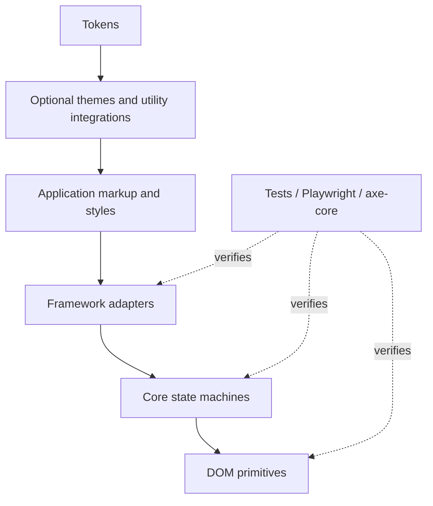

# Architecture — Forma UI

## Layer model

### Core

`@forma-ui/core` owns the interaction state machines, pure prop helpers and DOM services. It must not import framework runtimes, CSS or optional integration packages. Its exports are separated into `components/*` and `primitives/*` subpaths so applications can import only what they need.

### Framework adapters

Adapters translate framework lifecycle and reactivity into the core contract. They may create refs/signals/stores, bind callbacks, attach DOM refs and dispose resources. They must not fork the behavioral algorithm. An adapter may intentionally lag the core; the coverage table is the canonical statement of parity.

### Presentation and tokens

`@forma-ui/tokens` exports platform-neutral values and conversions. `@forma-ui/themes` applies explicit CSS custom properties. `@forma-ui/tailwind` and `@forma-ui/unocss` provide optional integration layers. They are not imported by core or automatically loaded by framework adapters.

### Developer experience

The docs app is a runnable behavioral playground. The CLI creates minimal integration entry points. Playwright exercises real browsers. Changesets manage package-level SemVer releases. `publint`, Are the Types Wrong and the export checker catch package distribution mistakes.

## Runtime boundaries

- No browser global access at module import time.
- DOM primitives receive or derive an owner document from the target element.
- Timers, event listeners, observers and subscriptions are registered at activation and removed through idempotent cleanup.
- SSR-safe helpers return deterministic data without requiring `window` or `document`.
- Every controller must state if it needs a mounted DOM node before behavior becomes active.

## State model

Where appropriate controllers support controlled and uncontrolled state:

- `value` / `open` means the consumer owns state.
- `defaultValue` / `defaultOpen` initializes internal state.
- callbacks report requested changes; they do not imply that a controlled owner accepted the change.
- controllers expose snapshots or prop getters but do not silently create rendering subscriptions unless explicitly documented.

## Error and cleanup model

Cleanup methods are idempotent. Destruction cancels timers, disconnects observers, removes listeners, destroys portals and releases global locks in reverse acquisition order. Destroyed controllers must not produce further callbacks from stale timers.

## Development applications

`apps/docs` is the product-facing playground and API explorer. `apps/storybook` is a separate isolation workbench for component states, design review and a11y-addon feedback. Both are development-only applications: neither is imported into the published core or framework adapters.
